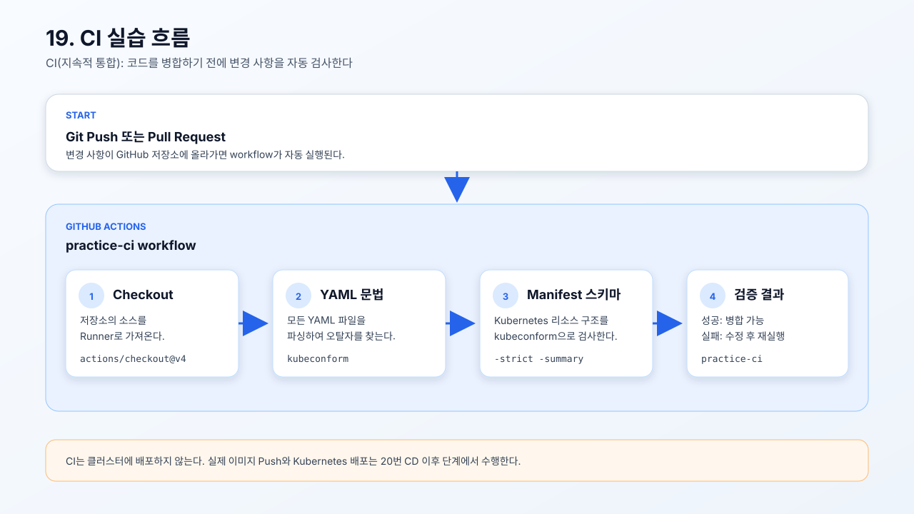

# 19. CI 검증

> 주의: `ci.yml`은 GitHub Actions workflow 파일이다. Kubernetes Manifest가 아니므로
> `kubectl apply -f 19-ci/`로 실행하지 않는다. `apiVersion`과 `kind`가 없는 것이
> 정상이며, `.github/workflows/ci.yml` 위치에 등록한다.

Pull Request와 `main` 브랜치 Push 시 Kubernetes Manifest를 자동 검증한다. 이 단계는 Kubernetes API Server에 배포하지
않으며, CI 실행 환경만으로 성공해야 한다.

- [실습용 CI workflow](./ci.yml)
- [manifest 검사 스크립트](../21-application-test/check-manifests.sh)
- [CI 실습 흐름 SVG](./ci-overview.svg)



`ci.yml`은 실습용 workflow 템플릿이다. 실제 GitHub 저장소에서 실행하려면
저장소 루트에 `.github/workflows/ci.yml`로 복사한다.

## CI란?

CI(Continuous Integration, 지속적 통합)는 개발자가 코드를 Git 저장소에
Push하거나 Pull Request를 만들 때마다 변경 사항을 자동으로 검사하는 방식이다.
문제가 있는 코드를 병합하기 전에 발견하는 것이 목적이다.

이 실습의 CI는 다음 작업만 수행한다.

- GitHub Actions Runner에서 저장소를 Checkout한다.
- `kubeconform`으로 YAML을 파싱하고 Kubernetes Manifest 스키마를 검사한다.
- 검사가 성공하면 병합 가능한 상태로 표시한다.

CI는 Kubernetes 클러스터에 배포하지 않는다. 실제 이미지 Push와 클러스터 배포는
CD 단계에서 수행한다.

```text
코드 작성
   ↓
Git Push 또는 Pull Request
   ↓
CI 자동 실행
   ↓
YAML·Kubernetes Manifest 검사
   ↓
성공 또는 실패 결과
```

CI와 CD의 역할은 다음과 같이 구분한다.

| 구분 | 역할 |
| --- | --- |
| CI | 코드와 Kubernetes 설정을 자동 검사한다. |
| CD | 검증된 이미지를 만들고 Kubernetes에 배포한다. |

따라서 19번 CI 실습은 클러스터에 배포하지 않고 Manifest가 올바른지만 확인한다.

Kubernetes 리소스를 직접 배포하려면 CI workflow가 아닌 해당 실습의 Manifest
디렉터리를 지정한다.

```bash
kubectl apply -f ci-practice/10-3tier/
```

위 명령은 3-Tier Kubernetes Manifest를 클러스터에 적용하는 예시이며, 19번 CI
workflow는 GitHub Actions에서 실행한다.

## 저장소 설정

GitHub Actions가 실행되려면 다음 조건을 준비한다.

### 1. Workflow 파일 등록

`ci.yml`은 `ci-practice/19-ci` 아래에 있는 템플릿이므로 GitHub가 인식하는
`.github/workflows` 디렉터리로 복사해야 한다.

```bash
mkdir -p .github/workflows
```

저장소 루트에 GitHub Actions 디렉터리를 만든다.

```bash
cp ci-practice/19-ci/ci.yml .github/workflows/ci.yml
```

CI workflow를 GitHub Actions가 실행할 수 있는 위치에 등록한다.

### 2. GitHub Actions 활성화

GitHub 저장소의 다음 메뉴에서 Actions가 허용되어 있는지 확인한다.

```text
Settings → Actions → General → Actions permissions
```

`Allow all actions and reusable workflows` 또는 조직 정책에 맞는 허용 옵션을
선택한다. 조직 저장소에서는 조직 정책이 개인 저장소 설정보다 우선할 수 있다.

### 3. 기본 권한 확인

현재 workflow는 다음 권한만 사용한다.

```yaml
permissions:
  contents: read
```

Manifest 검사만 수행하므로 Docker Hub 토큰, kubeconfig, Kubernetes Secret은
19번 CI에 필요하지 않다. 이미지 Push나 클러스터 배포 Secret은 이후 CD 단계에서
별도로 등록한다.

### 4. 실행 조건

현재 workflow는 다음 이벤트에서 실행된다.

```yaml
on:
  pull_request:
  push:
    branches: [main]
```

따라서 `main` 브랜치에 Push하거나 Pull Request를 생성하면 CI가 실행된다.

## `ci-test` 저장소로 실습하기

새 GitHub 저장소를 `ci-test`라는 이름으로 만든 뒤, 기존 프로젝트와 분리된
작업 디렉터리에서 다음 순서로 등록한다. 기존 Kubernetes 저장소는 그대로
보존한다.

### 1. 로컬 프로젝트 이동

```bash
cd /Users/jarrod/project/code-test
```

기존 `code-test` 작업 디렉터리로 이동한다.

```bash
mkdir ci-test
```

19번 이후 실습을 위한 새 작업 디렉터리를 만든다.

```bash
cd ci-test
```

새 작업 디렉터리로 이동한다.

```bash
git init
```

`ci-test`를 독립 Git 저장소로 초기화한다.

### 2. CI 검사 파일 복사

원본 `practice-order` 디렉터리 전체를 새 이름 `ci-practice`로 복사한다.

```bash
cp -R /Users/jarrod/project/code-test-check/k8s/practice-order ./ci-practice
```

원본 디렉터리의 내용 전체를 `ci-practice`라는 새 이름으로 복사한다.

```bash
mkdir -p .github/workflows
```

GitHub Actions workflow 디렉터리를 만든다.

```bash
cp ci-practice/19-ci/ci.yml .github/workflows/ci.yml
```

CI workflow를 GitHub Actions 실행 위치로 복사한다.

### 3. 원격 저장소 연결

```bash
git remote add origin https://github.com/<사용자명>/ci-test.git
```

`<사용자명>`을 GitHub 계정 이름으로 변경한다. 새 저장소이므로 이 디렉터리의
`origin`은 `ci-test` 저장소를 가리킨다.

```bash
git remote -v
```

### 4. 변경 사항 확인

```bash
git status
```

`.github/workflows/ci.yml`과 `ci-practice` 디렉터리가 대상에 포함되는지
확인한다.

### 5. Commit과 Push

```bash
git add .
```

`ci-test` 저장소에서 작성한 workflow와 검사 파일을 Commit 대상으로 등록한다.

```bash
git commit -m "ci: add Kubernetes manifest validation workflow"
```

변경 사항을 Commit한다.

```bash
git branch -M main
```

현재 브랜치 이름을 `main`으로 맞춘다.

```bash
git push -u origin main
```

`main` 브랜치를 GitHub의 `ci-test` 저장소에 Push한다. Push가 완료되면
`ci-test → Actions → practice-ci`에서 실행 결과를 확인한다.

`kubectl apply -f ci-practice/19-ci/`는 실행하지 않는다. `ci.yml`은 Kubernetes 리소스가
아니라 GitHub Actions workflow이기 때문이다.

## 실습 순서

### 1. 저장소 루트 확인

```bash
cd /Users/jarrod/project/code-test/ci-test
```

새 `ci-test` 저장소의 로컬 루트에서 실행한다.

### 2. Manifest 검사 도구 준비

CI에서는 workflow가 `kubeconform`을 자동 설치한다. 로컬에서 스키마 검사까지
실행하려면 다음 명령으로 설치한다.

```bash
GOBIN="${GOBIN:-$PWD/.bin}" go install github.com/yannh/kubeconform/cmd/kubeconform@v0.6.7
```

로컬 실행 경로에 도구를 추가한다.

```bash
export PATH="$PWD/.bin:$PATH"
```

### 3. CI 대상 Manifest 검사

```bash
bash ci-practice/21-application-test/check-manifests.sh
```

`frontend.yml`, `backend.yml`, `11-ingress/ingress.yml`을 kubeconform으로
검사한다. kubeconform이 YAML 파싱과 Kubernetes 리소스 스키마 검사를 함께
수행하므로 별도의 Ruby 문법 검사가 필요하지 않다.

### 4. GitHub Actions workflow 등록

```bash
mkdir -p .github/workflows
cp ci-practice/19-ci/ci.yml .github/workflows/ci.yml
```

workflow를 GitHub Actions가 인식하는 위치에 복사한다. 저장소에 Push하거나
Pull Request를 생성하면 `practice-ci` workflow가 실행된다.

### 5. 로컬 검증 스크립트 실행

```bash
bash ci-practice/21-application-test/check-manifests.sh
```

GitHub에 Push하기 전에 CI의 Manifest 검사 단계를 로컬에서 먼저 확인한다.

## CI와 CD의 경계

19번 CI는 YAML 파싱과 Manifest 스키마 검사를 수행한다. 따라서
Kubernetes API Server, kubeconfig, 운영 클러스터를 요구하지 않는다.

실제 이미지 Push와 클러스터 배포는 다음 단계에서 수행한다.

- 20번: CD workflow와 배포 준비
- 22~23번: 이미지 빌드와 Docker Hub Push
- 24번: Kubernetes Rollout 확인

`kubectl apply --dry-run`은 kubeconfig와 API discovery를 요구할 수 있으므로
19번 CI의 기본 검사에는 사용하지 않는다.

검증 항목은 kubeconform의 YAML 파싱 및 Kubernetes Manifest 스키마 검사다.
